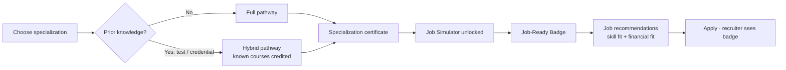
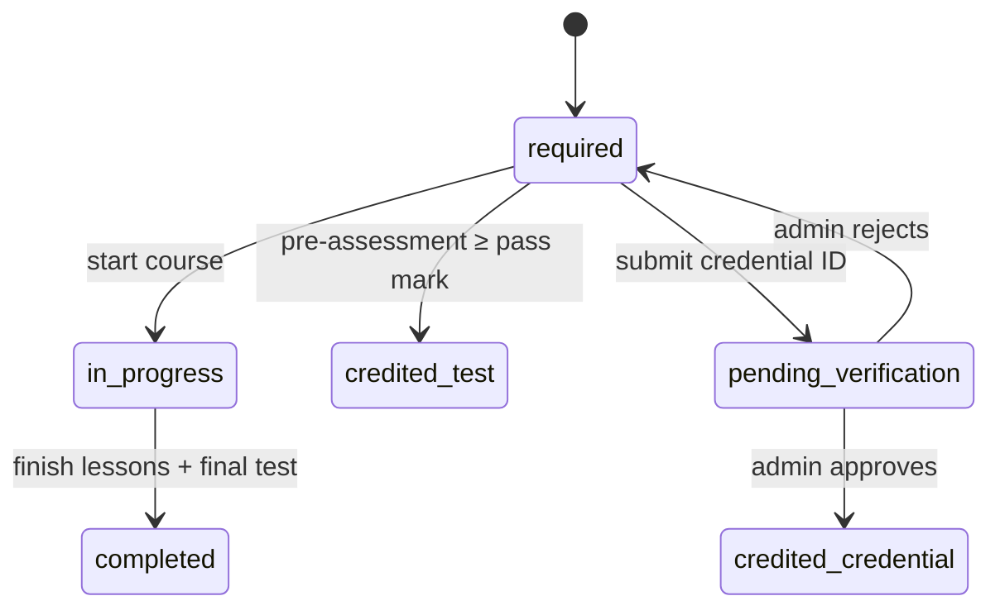
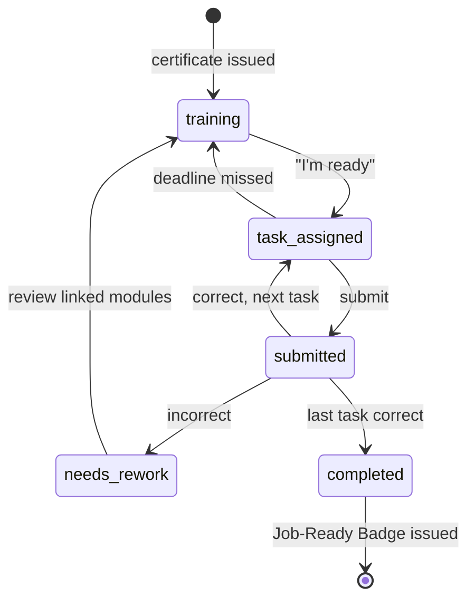
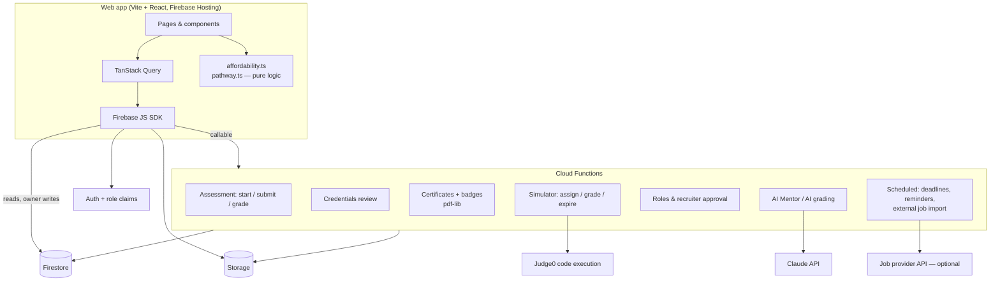

# UdyamPath — Platform Plan & Phase-wise Execution

> **What this is:** the single source of truth for rebuilding UdyamPath into a Coursera-style learning platform with three features no current platform combines:
> **(1) Hybrid Pathway**, **(2) Course-End Job Simulator**, **(3) Cost-of-Living-aware Job Recommendation**.
>
> **Ground rule:** *Nothing that exists today is dropped.* Every current screen and feature is listed in [§4 Feature Preservation Matrix](#4-feature-preservation-matrix) with the place it lives in the new platform. Things are fixed, moved or upgraded, never deleted. The only exceptions are dead code and unused libraries (§4.9).
>
> **One plan sheet:** §8 holds every phase of work: the platform build *and* the page-by-page UI redesign that used to live only in `.github/agents/vishwakarma.agent.md` (the "Vishwakarma" design phases V1–V9). See [§8.1](#81-ui-redesign-track-vishwakarma-v1v9) for how they map.
>
> Companion doc: [DESIGN_PRINCIPLES.md](DESIGN_PRINCIPLES.md) (visual and interaction system). Where the Vishwakarma agent file and DESIGN_PRINCIPLES.md disagree, **DESIGN_PRINCIPLES.md wins**.
> Source diagrams: `specialfeature1.png` (Hybrid Pathway), `specialfeature2.png` (Job Simulator), `specialfeature3.png` (Job Recommendation), `dfd1.png` (data flow), `merge.png` (how the three connect).

---

## Table of contents
1. [Vision & the gap we fill](#1-vision--the-gap-we-fill)
2. [Where we are today (audit summary)](#2-where-we-are-today-audit-summary)
3. [The three special features — functional spec](#3-the-three-special-features--functional-spec)
4. [Feature Preservation Matrix](#4-feature-preservation-matrix)
5. [Target infrastructure & architecture](#5-target-infrastructure--architecture)
6. [Data model](#6-data-model)
7. [Routes / information architecture](#7-routes--information-architecture)
8. [Execution plan — phases](#8-execution-plan--phases) (includes the [UI redesign track](#81-ui-redesign-track-vishwakarma-v1v9))
9. [Quality bar: Definition of Done, testing, performance](#9-quality-bar)
10. [Risks & decisions to confirm](#10-risks--decisions-to-confirm)

---

## 1. Vision & the gap we fill

UdyamPath is a **student-first career platform for Indian students**, with a special focus on Tier-2 and Tier-3 cities. It takes a learner from *"I want to become X"* to *"I have a job I can actually afford to live on"*.

| Problem today | Coursera / Udemy / Naukri do… | UdyamPath does… |
|---|---|---|
| Rigid learning paths | Same full syllabus for everyone | **Hybrid Pathway**: prove what you already know (test or credential) and skip it |
| No job-like practice | Certificate = end of journey | **Job Simulator** unlocks after the certificate: real tasks, real deadlines, graded, **Job-Ready Badge** |
| Job matching ignores money | Filter by salary only | **Financial fit**: salary vs. cost of living in the job's city, for *your* lifestyle level |

How the three connect (from `merge.png`):



**Three user roles:** `learner` (today "Candidate"), `recruiter`, and a new `admin` role. Admins are needed to verify credentials, approve recruiters and manage content.

---

## 2. Where we are today (audit summary)

**Stack:**
- Create React App (react-scripts 5, which is now deprecated), React 19, React Router 6.
- Firebase Auth. The **Realtime DB** holds only `users/{uid}`; **Firestore** holds recruiter content, applications and test scores.
- All other data is static JSON in `/public`.
- About 23k lines of JSX, mostly inline style objects.

**What is good and must be kept:**
- A broad feature set: courses, specializations, jobs, city costs, resume check, interview prep, notes-to-mind-map, flashcards, PYQs, recruiter posting and the events carousel.
- Lazy-loaded routes.
- Plus Jakarta Sans and an existing token start in `src/index.css`.
- The shared components in `components/shared/`: GlassCard, AnimatedSection, PageTransition, SkeletonCard.

**Critical gaps:**

| Area | Finding |
|---|---|
| Hybrid Pathway | Exists only as marketing text in a "Learn More" modal. No pre-assessment, no skip logic, no credential entry. Pathway progress is lost on reload. |
| Certificates | Do not exist. The pathway "Final Assessment" has literal *Pass Test / Fail Test* buttons. |
| Job Simulator | A mock. It is not gated on a certificate (completed courses are hardcoded). The timer counts up and there are no deadlines. Grading is a `setTimeout` with canned text. There is no badge and nothing is persisted. |
| Job recommendation | **The job list never renders**: `details.jsx` looks up `c.name` but the JSON key is `city`. Salaries mix monthly and annual values. There is no lifestyle level and no on-site/hybrid/remote logic. Job locations are US cities. |
| Data & state | Pages depend on `location.state`, so they break on refresh or direct link. Three databases are used (RTDB, Firestore, localStorage). Profile edits are never saved. `enrolledCourses` is always empty. |
| Security | No Firestore/RTDB/Storage rules in the repo. Users pick their own role, so anyone can become a recruiter. Google sign-in overwrites the role with "Candidate". Test answers ship to the browser in JSON. |
| Quality | Files of 700–1500 lines. Duplicated fetch/list/quiz code (3 quiz implementations). ~10 unused heavy dependencies (tfjs, coco-ssd, react-flow v1…). Weak accessibility. Pages other than home and courses are not mobile-friendly. |

---

## 3. The three special features — functional spec

### 3.1 Hybrid Pathway (`specialfeature1.png`)

**Flow:**
1. The learner picks a **specialization (profile)**, for example *Full-Stack Web Development*.
2. They see the **pathway from beginner to job-ready**: an ordered list of courses.
3. **Onboarding question:** *"Do you already know any course in this pathway?"*
   - **No** → all courses are mandatory (normal pathway).
   - **Yes** → for each course they claim to know, they pick a source from a list:
     - **A recognized platform** (Coursera, edX, Udemy, NPTEL, LinkedIn Learning, Google, Microsoft Learn, AWS Skill Builder, IBM SkillsBuild, Infosys Springboard, …) → they **take a test** (the pre-assessment).
       - **Passed** (score ≥ course pass mark, default 70%) → the course is marked **Credited (by test)**.
       - **Failed** → the course stays **Mandatory**. The per-module result still shows where they are weak.
     - **Institutional knowledge** (college or university course) → they enter a **Credential ID** with institution name, optional verification URL and an uploaded certificate file.
       - The claim goes to the admin review queue, and the course shows **Credit pending**.
       - **Approved** → **Credited (by credential)**. **Rejected** → **Mandatory**, and the reason is shown.
4. The result is the **Hybrid Pathway**: known courses are marked complete, and a banner shows *"You saved ~N weeks"*.

**Rules:**
- **Pre-assessment** draws questions from a server-side question bank. Each question is tagged with `moduleId` and `skillTag`.
  - A whole-course pass credits the course.
  - On a partial result, modules scoring ≥ 80% are marked **"Tested out"** inside the course. This is the module-level adaptivity described in the project report (§3.2.2).
- **Anti-gaming:** answers are never sent to the client and grading happens on the server. Each course allows **1 attempt per 7 days**. Test mode includes a timer, fullscreen and the existing camera/face-presence check.
- **Credited courses count toward the specialization certificate.** The certificate lists them honestly, e.g. *"2 of 6 courses credited via prior learning"*.
- **Dynamic recommendations:**
  - After any assessment, suggest the lessons tagged with the learner's weak `skillTag`s.
  - On the "My Learning" page, suggest complementary courses.
- **Future (already designed for):** automatic credential verification through provider URLs/APIs. `providers.verifyUrlPattern` is stored now so this can be added later.

**Course status chips:**

| Status | Meaning |
|---|---|
| `locked` | Prerequisites are not done |
| `required` | Not started |
| `in_progress` | Started |
| `completed` | Finished by learning |
| `credited_test` | Passed the pre-assessment |
| `credited_credential` | Credential approved |
| `pending_verification` | Credential awaiting admin review |



### 3.2 Certificates (bridge between features 1 and 2)

- A **course certificate** is issued when all lessons are complete and the course final test is passed. This is the same as Coursera.
- A **specialization certificate** is issued when every pathway course is `completed` or `credited_*`.
- Each certificate is:
  - A PDF generated **server-side** with `pdf-lib`, which is already a dependency.
  - Identified by a unique ID and a public verification page at `/verify/certificate/:id`.
  - Shareable through an "Add to LinkedIn" button.
- **The specialization certificate unlocks that field's Job Simulator.**

### 3.3 Course-End Job Simulator (`specialfeature2.png`)

**Flow:**
```
Certificate generated → Simulator for that field unlocked → Training
→ Task Assigned (with deadline)
    ├─ Not submitted by deadline → back to Training (a new task variant is assigned)
    └─ Submitted → graded
          ├─ Incorrect → show issues + link to the exact module/lesson for each error → Training
          └─ Correct  → next task … all tasks done → Job-Ready BADGE for that field
```



**Simulator track:** each specialization gets one track, for example *Junior Frontend Developer @ a fictional company "Nimbus Retail"*. A track contains:
- **Training**: a role briefing, the tools used at work, a worked example, and links back to the relevant modules.
- **3–5 tasks** that mimic real work. These are the task types in the project report:

| Task type | Example | How it's graded |
|---|---|---|
| `code` | Debug a failing checkout function; add a feature to a starter repo | Hidden test cases run through a code-execution API (Judge0) |
| `report` | Write a marketing campaign report or a financial analysis memo | Rubric + AI grading (Claude API), structured checks (required sections, numbers) |
| `scenario` | Team-collaboration or client-email situation with branching choices | Rule-based scoring of the choices |
| `data` | Clean a CSV, compute KPIs, build a chart | Numeric answer checks with tolerance |

**Details:**
- **Deadlines** use real time: by default 48 hours from assignment, set per task. A scheduled job expires overdue tasks. Learners get reminders at 24h and 2h.
- **Error → module mapping:** each grading check has a `moduleRef {courseId, moduleId, lessonId}`. Feedback lists every failed check with a **"Revise: <Lesson name>"** link. This is what makes the simulator part of the learning loop rather than a quiz.
- **Job-Ready Badge:**
  - Records the field, level, issue date, evidence (task scores) and a public verify page at `/verify/badge/:id`.
  - Shows on the profile and on every job application, so recruiters can filter by it.
  - Boosts matching jobs in recommendations (see `merge.png`).
- **The existing `/job-simulator` is kept.** It becomes **"Interview Simulator — Quick Practice"** inside the Simulator hub, with its 10 roles × 4 levels × 3 rounds. It needs no unlock, gets real persistence, and its random-question bug is fixed.

### 3.4 Financial Job Recommendation + Expense Dashboard (`specialfeature3.png`)

**Inputs** (collected once during onboarding and editable in the profile):
- **Current city**
- **Lifestyle level**: Low / Medium / High
- **Living arrangement**: Shared / Single (changes the rent multiplier)
- Preferred cities and work modes (optional)

**Classification:**
```
Job seeker → city they live in
├─ Remote (virtual) job ................................ show all  (chip: "Remote")
└─ On-site / Hybrid job
   ├─ Job city == user's city ......................... show all  (chip: "Your city")
   └─ Job city != user's city → monthly expense(jobCity, lifestyle, arrangement)
        ├─ In-hand salary ≥ expense + savings buffer → RECOMMENDED   (shows +₹surplus)
        └─ In-hand salary <  expense ............... NOT RECOMMENDED (shows −₹shortfall + why)
```

**Engine** (a pure TypeScript module `src/features/cost-of-living/lib/affordability.ts`, unit-tested and shared with Cloud Functions):

1. **Expense:**
   `expense(city, tier, arrangement) = Σ categories (rent, food, transport, utilities, misc, other)`, each with low/med/high values. Rent is multiplied by 0.6 for shared housing.
2. **Salary normalization:**
   - Jobs store `{min, max, period: "month" | "year"}`.
   - Monthly gross = annual ÷ 12.
   - **Estimated in-hand** = gross − EPF (12% of an assumed 50% basic) − professional tax − income tax (current new-regime slabs). The exact formula is documented in code.
   - Internship stipends are taken as-is.
   - The UI always says "estimated" and shows the breakdown.
3. **Buffer:** default savings target is 10% of in-hand, and the user can change it.
4. **Alert:** opening or applying to a *Not Recommended* job shows a warning. It gives the shortfall by category and suggests cheaper nearby options.

**Expense Dashboard** (upgrade of `/base` and `CityDetailsModal`):
- City search across **~25 cities**, adding Tier-2/3 cities: Indore, Jaipur, Lucknow, Bhopal, Coimbatore, Chandigarh, Kochi, Nagpur, Bhubaneswar, Patna, Dehradun…
- The **six category tiles** stay, and a lifestyle toggle is added.
- Side-by-side comparison of 2–3 cities.
- A "salary needed in this city" calculator.
- The existing pie chart stays, plus a stacked-bar comparison.
- The "monthly variations" chart is **kept but fed real quarterly snapshots** (`cities/{id}/history`). The values are currently fabricated, and fake numbers are not acceptable on a money feature.
- Every city shows **data source + last updated**. Admins can edit city data.

**Job data:**
- Jobs get **Indian city IDs**, `mode` (onsite/hybrid/remote) and normalized salary.
- Recruiter posting already captures *mode*. It gains city and salary-period fields.
- *(Optional, Phase 8)* External listings from a job API with India coverage (e.g. Adzuna) are merged in with `source: "external"`. This matches the "Job Provider API" in `dfd1.png`.

---

## 4. Feature Preservation Matrix

Legend: **Keep** = same behavior, restyled · **Fix** = currently broken, will work · **Upgrade** = gains persistence or real logic · **Move** = new URL/location (old URL redirects).

### 4.1 App shell & auth
| Feature (today) | File(s) | Target | Phase |
|---|---|---|---|
| Sticky header + nav (Courses, Opportunity, Tools, Login/Profile/Logout) | `App.js` | Keep → `components/layout/Header` | 1 |
| Mobile bottom dock (Home, Courses, Jobs, Tools, Profile) | `App.js` | Keep, add labels and accessibility | 1 |
| Footer (Products, Tools, Contact) | `App.js` | Keep → `components/layout/Footer` | 1 |
| Auth modal: email/password, Google, role tab (Candidate/Recruiter) | `AuthModal.jsx`, `firebase.js` | **Fix** role overwrite + redirect race; add password reset | 0, 2 |
| LinkedIn sign-in button (no handler) | `AuthModal.jsx` | **Fix** via OIDC provider, or hide behind a flag until configured | 2 |
| `/login`, `/signup` open the modal | `App.js` | Keep | 1 |
| Founder note modal (pops up after 20s) | `FounderModal.jsx` | Keep; show **once per user** (dismissal remembered) | 0 |
| Protected / recruiter routes | `App.js` | Upgrade to role claims (`learner`/`recruiter`/`admin`) | 2 |

### 4.2 Homepage
| Feature | File(s) | Target | Phase |
|---|---|---|---|
| Hero (See More, Hire Talent) | `homepage.jsx` | Keep; "See More" scrolls to features (currently does nothing) | 1 |
| 3 glass cards → Jobs / Courses / Tools | `homepage.jsx` | Keep | 1 |
| New Feature section | `newFeature.jsx` | Keep; merge in the better parts of `newFeature_updated.jsx`, then delete the duplicate | 1 |
| Popular course carousel | `popular.jsx` | Upgrade: real catalog data | 3 |
| HomeTool (Interview Practice, Projects, Mentora, Supportive Tools) | `hometool.jsx` | Keep; Mentora → AI Mentor (Phase 7) | 1, 7 |
| How it works | `howitworks.jsx` | Keep; update to show the 3-feature journey | 1 |
| Events carousel (recruiter workshops / hackathons / quizzes) | `event.jsx` | Keep | 1 |
| FAQ | `FaqPage.jsx` | Keep | 1 |

### 4.3 Courses & learning
| Feature | File(s) | Target | Phase |
|---|---|---|---|
| "Customized path" banner + Learn More modal | `coursepage.jsx` | Upgrade → real entry to the Hybrid Pathway | 4 |
| 60-Second Learning (typewriter, timer) | `coursepage.jsx` | Keep; move topics to data; fix interval leak | 3 |
| Daily Challenge + Code Editor overlay | `coursepage.jsx`, `CodeEditor.jsx` | Upgrade: real code execution (Judge0) instead of `Math.random()`; fix `onClose` | 3, 6 |
| Job Simulator promo card | `coursepage.jsx` | Keep → links to Simulator hub | 6 |
| Visual Notes promo | `coursepage.jsx` | Keep | 3 |
| Tabs: Course / Specialization / My Learnings | `coursepage.jsx` | Keep as `/explore` + `/learn` | 3 |
| Recently viewed / Most popular / New / Recommended lists | `recentView`, `mostPopular`, `newOnUdyamPath`, `recommendedCourse` | Upgrade: one `CourseRow` component + real queries (recently viewed is tracked per user) | 3 |
| Course detail (about, skills, module accordion) | `coursedetail.jsx` | Keep; URL `/courses/:slug`; fix "undefined coding exercises" | 3 |
| AI Mentor card (dead `/ai-mentor` link) | `coursedetail.jsx` | **Fix**: real AI Mentor | 7 |
| Module / lesson player (text, video, pdf, image), progress | `modulePage.jsx` | Upgrade: `/courses/:slug/learn/:lessonId`, saved progress, fix "Start Module" lookup bug, 100% completion | 3 |
| Course completion quiz | `modulePage.jsx` | Keep; uses the shared Assessment engine | 3 |
| Proctored test (camera, face check, fullscreen, unload guard) | `TestPage.jsx` | Upgrade: server grading; face check via `face-api.js` (model already in `public/models`) instead of the auto-passing native API; stop camera on exit | 3 |
| Specialization list + search (16) | `SpecializationPage.jsx` | Keep | 3 |
| Specialization detail (courses, pathway timeline, careers, companies) | `SpecializationDetail.jsx` | Keep + hybrid pathway status | 4 |
| Pathway phase detail (content/videos/pdfs/exercises, mark complete) | `PathwayPhaseDetail.jsx` | Upgrade: data-driven (stop ignoring the JSON), saved progress | 3 |
| Final assessment + confetti | `PathwayPhaseDetail.jsx` | **Fix**: real test → certificate; keep the confetti | 3 |
| My Learnings (progress, remove) | `MyLearningsPage.jsx` | **Fix**: real enrollments; remove the manual ±10% buttons (progress becomes automatic) | 3 |
| Job Simulator (10 roles × 4 levels × 3 rounds) | `JobSimulator.jsx` | Keep as "Interview Simulator — Quick Practice", persisted | 6 |

### 4.4 Jobs & cost of living
| Feature | File(s) | Target | Phase |
|---|---|---|---|
| Job / Internship tabs + card grid | `jobpage.jsx`, `details.jsx` | **Fix** (currently never renders) + affordability chips | 0, 5 |
| Filters (type, level) | `details.jsx` | Upgrade: + mode, city, salary, recommended-only, badge match | 5 |
| City input on jobs page | `jobpage.jsx` | Upgrade → profile city + lifestyle (still editable inline) | 5 |
| "Apply" modal (only shows "Yayy") | `jobpage.jsx` | **Fix**: real application | 5 |
| Job details + application form + math captcha | `jobDetails.jsx` | Keep; upload resume/cover letter to Storage (today only the filename is saved) | 5 |
| Internship apply | `internApply.jsx` | Keep; fix navigate-in-render | 0, 5 |
| City cost pie modal | `CityDetailsModal.jsx` | Keep | 5 |
| City cost dashboard `/base` (six tiles, trend chart) | `basePage.jsx`, `baseDetails.jsx` | Upgrade → `/cost-of-living` (Expense Dashboard §3.4) | 5 |
| Resume check (PDF/DOCX, role keywords, score, feedback) | `ResumeCheck.jsx` | Keep; optional AI feedback in Phase 7 | 7 |
| Interview checklist | `InterviewCheck.jsx` | Keep; save checklist state per user | 7 |

### 4.5 Tools (career prep)
| Feature | File(s) | Target | Phase |
|---|---|---|---|
| Tech interview Q&A | `techInterview.jsx`, `techdata.json` | Keep | 7 |
| HR interview + user experiences | `hrInterview.jsx` | Keep; experiences saved to Firestore when logged in | 7 |
| Group discussion topics | `groupDiscussion.jsx` | Keep | 7 |
| Placement papers + placement test | `placementpaper.jsx`, `placeTest.jsx` | **Fix** missing company PDFs and the Microsoft icon; test uses the shared engine | 0, 7 |
| Communication (speech-to-text) | `communication.jsx` | Keep | 7 |
| Adaptability quiz | `adaptability.jsx` | Keep; persist | 7 |
| Time management (timed Monaco challenges) | `timemanage.jsx` | **Fix**: output actually computed | 7 |
| Projects list, project modal, project details | `project.jsx`, `projectModal.jsx`, `projectlist.jsx` | Keep; URL `/tools/projects/:slug` | 7 |
| Mentora button on tools (`navigate("")`) | `toolspage.jsx` | **Fix** → AI Mentor | 7 |

### 4.6 Notes & study
| Feature | File(s) | Target | Phase |
|---|---|---|---|
| Notes hub (flash notes, notification marquee, books search, PYQ tiles) | `notespage.jsx` | Keep; fix rAF/interval leaks; add to main nav | 7 |
| PDF/text → mind map / flowchart, PNG export | `notes.jsx`, `Modal.jsx`, `DiagramViewer.jsx` | Upgrade: save diagrams per user; de-duplicate the generators | 7 |
| Flashcards (categories, shuffle, mastered, bookmarks, confetti) | `FlashCard.jsx` | Keep; sync bookmarks and progress when logged in | 7 |
| PYQs (21 PDFs, search, filter, grid/list, view/download) | `PyqPage.jsx`, `public/pyq` | Keep | 7 |
| Books + recommended books | `books.jsx`, `RecommendedBooks.jsx` | Keep; persist bookmarks | 7 |
| "Upgrade to Plus" modals (2 copies) | `hometool.jsx`, `notespage.jsx` | Keep as one component; button joins a **waitlist** instead of `alert()` | 7 |

### 4.7 Profile
| Feature | File(s) | Target | Phase |
|---|---|---|---|
| Banner + photo upload, name, location | `profile.jsx` | **Fix**: saved (Storage + Firestore) | 2 |
| 5-tab detail form (Personal, Education, Experience, Skills, Documents) | `detailform.jsx`, `renderForm.jsx` | **Fix**: saved; + lifestyle & city preferences | 2 |
| Highlights + links (LinkedIn, Portfolio, GitHub) | `ProfileEditModal.jsx` | Keep; persisted | 2 |
| *(new)* Certificates & badges showcase | — | New | 3, 6 |

### 4.8 Recruiter
| Feature | File(s) | Target | Phase |
|---|---|---|---|
| Dashboard (counts, 8 recent applications) | `RecruiterHome.jsx` | Keep + applicant detail, status pipeline, badge filter | 8 |
| Post Job/Internship (mode, salary, rounds, …) | `JobInternshipModal.jsx` | Upgrade: Indian city picker, salary period | 5 |
| Post Workshop / Quiz / Hackathon | `WorkshopModal`, `QuizModal`, `HackathonModal` | Keep | 8 |
| Recruiter header | `recruiter.jsx` | Keep → `RecruiterShell` layout | 8 |

### 4.9 Removed — code only, no user-facing feature lost
- **Dead files:** `components/{login,signup,profile,toolspage}/sample.jsx`, `pages/login.jsx`, `pages/signup.jsx` (not imported), `newFeature_updated.jsx` (after its content is merged), `App.css`, `logo.svg`.
- **Unused dependencies:** `@tensorflow/tfjs`, `@tensorflow-models/coco-ssd`, `react-flow` (v1; `reactflow` v11 is the one in use), `react-mindmap`, `@react-pdf-viewer/*`, `d3-timer`, `react-transition-group`, `fortawesome` (a placeholder package), `cra-template`, `react-router` (duplicate of `react-router-dom`).
  - **`face-api.js` is kept and wired up**, because the test-page face check is a real feature.
  - **`pdf-lib` is kept** for certificate generation.
- **Icon libraries:** Font Awesome and `react-icons` are phased out in favor of `lucide-react` only (see design doc).

---

## 5. Target infrastructure & architecture

### 5.1 Decisions (summary)

| Concern | Today | Target | Why |
|---|---|---|---|
| Build tool | CRA (deprecated) | **Vite** | Fast dev and builds; CRA no longer maintained |
| Language | JS | **TypeScript** for new code (`allowJs` for gradual migration) | Data model is getting complex (statuses, money) |
| Routing | RR6 + `location.state` | React Router (data router), **URL params only** | Deep links and refresh must work |
| Server state | ad-hoc `fetch` in every component | **TanStack Query** | Caching, loading/error states, de-duplication |
| Forms | manual | **react-hook-form + zod** | Validation shared with Functions |
| Styling | inline style objects | **Tailwind CSS v4 + CSS variable tokens** + Radix primitives | See DESIGN_PRINCIPLES.md |
| Auth | Firebase Auth | Firebase Auth + **custom claims** for roles | Roles can't be self-assigned |
| Database | RTDB + Firestore + localStorage | **Firestore only** (one-time `users` migration from RTDB) | One model, queryable, rules-protected |
| Files | none (filenames only) | **Firebase Storage** (resumes, photos, credential proofs, certificate PDFs) | — |
| Trusted logic | none (all client) | **Cloud Functions for Firebase** (Node 20, TS) | Grading, certificates, badges, roles, deadlines |
| Code execution | `Math.random()` | **Judge0 CE** (hosted API to start, self-hosted later) + in-browser pre-run (Pyodide / sandboxed iframe) for instant feedback | Real tests for Daily Challenge, Code Editor and simulator code tasks |
| AI | none | **Claude API** (`claude-sonnet-5-5` for grading/mentor, `claude-haiku-4-5-20251001` for cheap tasks), called **only from Functions** | Report grading, AI Mentor, resume feedback, question drafting (admin-reviewed) |
| Hosting | — | **Firebase Hosting** + preview channels per PR | Same project as auth/db |
| CI | none | **GitHub Actions**: lint, typecheck, unit, rules tests, build, preview deploy | — |
| Monitoring | none | Firebase Analytics (GA4) + Sentry (free tier) | Funnel metrics for the project report |
| Local dev | — | **Firebase Emulator Suite** + seed script | No one tests against production |

> **Firebase API key note:** Firebase web keys are public by design, so the key is not a secret. The real problem is the missing **security rules**. Config has already moved out of `firebase.js` into env files (`REACT_APP_FIREBASE_*` in `.env`, `.env.development`, `.env.local`, all git-ignored; `.env.example` is the committed template). Phase 1 renames them to `VITE_FIREBASE_*` and splits dev and prod projects. The old key is still in git history from the first commit, which is acceptable for a web key.
>
> **Cost note:** Cloud Functions require the **Blaze (pay-as-you-go)** plan. Student-scale usage fits inside the free quota. Set a **₹500 budget alert**. If Blaze is not possible, the fallback is the same function code deployed as Vercel/Render serverless endpoints using the Firebase Admin SDK.

### 5.2 Architecture diagram (maps to `dfd1.png`)



DFD mapping:

| `dfd1.png` element | Implemented by |
|---|---|
| Learning Path Customization | `pathway` feature + assessment functions |
| User Management | Auth, `users`, roles |
| Job Recommendation System | `affordability.ts` + jobs queries |
| Job Simulation & Assessment | simulator functions |
| Learning Content | `courses/…` collections |
| User Profiles | `users` |
| Job Listings | `jobs` |
| Simulation Scenarios | `simulatorTracks` |
| Assessment Results | `assessmentAttempts`, `simulatorSubmissions` |
| "Simulation Performance Details → User Profiles" | Badge and skill scores written to the profile |

### 5.3 Repository structure

```
aspiro/
├─ src/
│  ├─ app/                 router.tsx, providers.tsx, layouts/ (AppShell, LearnerFocus, RecruiterShell, AdminShell)
│  ├─ components/
│  │  ├─ ui/               Button, Card, Dialog, Tabs, Chip, Progress, Skeleton, Toast, EmptyState, Money, …
│  │  └─ layout/           Header, MobileDock, Footer
│  ├─ features/
│  │  ├─ auth/  home/  catalog/  course/  player/  assessment/  pathway/  certificates/
│  │  ├─ simulator/  jobs/  cost-of-living/  career-tools/  notes/  profile/
│  │  └─ recruiter/  admin/  mentor/
│  │     └─ <feature>/{pages,components,hooks,api.ts,types.ts,lib/}
│  ├─ lib/                 firebase.ts, queryClient.ts, format.ts (₹ en-IN), analytics.ts
│  ├─ content/             static reference JSON (flashcards, HR/tech Qs, PYQ index, projects)
│  └─ styles/              tokens.css, globals.css
├─ functions/              Cloud Functions (TypeScript)
├─ scripts/seed/           converts current public/*.json → Firestore (emulator & prod)
├─ firestore.rules  firestore.indexes.json  storage.rules  firebase.json
├─ e2e/                    Playwright tests
└─ plans/                  this doc, DESIGN_PRINCIPLES.md, diagrams
```

**Migration style: strangler, not a rewrite.**
1. Move CRA to Vite in place.
2. Build the new shell.
3. Rebuild one feature at a time under `src/features`.
4. Old routes stay alive until their replacement ships, then **redirect** to the new URL.

---

## 6. Data model

Firestore collections. 🔒 = server-only (Functions write, and clients can't read secrets).

```
users/{uid}
  displayName, email, photoPath, phone, role (mirror of claim), recruiterStatus?: pending|approved
  location: {cityId, state}
  preferences: {lifestyle: low|medium|high, arrangement: shared|single, preferredCityIds[], workModes[], savingsBufferPct}
  education[], experience[], skills[], links{linkedin,github,portfolio}, highlights[], documents[{name,path}]
  onboarding: {completed, founderNoteSeen}
  └─ private/ (owner-only): diagrams/, flashcardProgress, bookmarks/, hrExperiences/, checklists/, recentlyViewed/

providers/{id}                 name, logo, type: platform|institution, verifyUrlPattern?
specializations/{id}           slug, title, description, image, level, durationWeeks, accent,
                               courseIds[] (ordered), careerPaths[], companies[], simulatorTrackId, published
courses/{id}                   slug, title, provider{name,logo}, level, durationHours, skills[], description,
                               image, passMark, preAssessment{questionCount, timeLimitMin}, published, rating?
  └─ modules/{id}              order, title, summary, skillTags[]
       └─ lessons/{id}         order, type: video|text|pdf|image|code|quiz, title, durationMin, content{…}
questionBanks/{courseId}/questions/{id}  🔒  moduleId, skillTag, usage: pre|quiz|final, type, prompt,
                                             options[], correct, explanation, difficulty

enrollments/{uid_courseId}     uid, courseId, specializationId?, status, progressPct, lessonsDone{lessonId: ts},
                               lastLessonId, startedAt, completedAt
pathwayPlans/{uid_specId}      uid, specId, courses{courseId: {status, source, attemptId?, claimId?}},
                               weeksSaved, createdAt, updatedAt
assessmentAttempts/{id}    🔒w  uid, courseId, kind: pre|quiz|final, questionIds[], startedAt, expiresAt,
                               submittedAt, score, perModule{}, passed, proctor{faceMissingSec, tabSwitches}
credentialClaims/{id}          uid, courseId, specId, institution, credentialId, url?, proofPath,
                               status: pending|approved|rejected, reviewerUid?, reason?, timestamps
certificates/{id}          🔒w  uid, kind: course|specialization, refId, title, recipientName, issuedAt,
                               creditedCourseIds[], pdfPath          (public read for /verify)

simulatorTracks/{id}           specId, title, role, company (fictional), training[{type,title,body,moduleRefs[]}],
                               taskIds[], passPolicy
  └─ tasks/{id}                order, type: code|report|scenario|data, title, brief, deliverables[],
                               deadlineHours, checks[{id, label, weight, skillTag, moduleRef{courseId,moduleId,lessonId}}]
  └─ taskKeys/{taskId}     🔒  hidden tests, rubric, expected values, variants[]
simulatorRuns/{uid_trackId}🔒w  state: training|task_assigned|submitted|needs_rework|completed,
                               currentTaskId, variant, assignedAt, dueAt, history[]
simulatorSubmissions/{id}  🔒w  uid, runId, taskId, payload{code|text|filePath|answers}, submittedAt,
                               grade{score, passed, failedChecks[{checkId, message, moduleRef}]}, gradedBy: auto|ai|mentor
badges/{id}                🔒w  uid, trackId, field, level, issuedAt, evidence[]   (public read for /verify)
interviewPractice/{id}         uid, role, level, round, answer, feedback, createdAt   (Quick Practice history)

cities/{id}                    name, state, tier: 1|2|3, image,
                               costs{rent|food|transport|utilities|misc|other: {low, medium, high}},
                               sources[], updatedAt
  └─ history/{yyyy-qN}         costs snapshot
jobs/{id}                      source: recruiter|seed|external, recruiterId?, kind: job|internship,
                               company{name,logo}, title, mode: onsite|hybrid|remote, cityIds[],
                               salary{min,max,period: month|year}, level, experience, skills[],
                               responsibilities[], preferredBadgeFields[], rounds[], applyBy, status, postedAt
applications/{id}              jobId, uid, recruiterId, resumePath, coverLetterPath, answers{}, badgeIds[],
                               status: submitted|viewed|shortlisted|rejected|hired, createdAt
workshops/{id} · quizzes/{id} · hackathons/{id}   recruiterId, … (moved from Recruiters/{uid}/… subcollections)
waitlist/{id}                  uid?, email, feature: plus|mentor, createdAt
notifications/{uid}/items/{id} type, title, body, link, read, createdAt
```

**Security rules** (enforced and tested in CI):
- Users read and write **only their own** `users/{uid}` (the role field is excluded) and their own `private/`.
- Catalog collections are public read and admin write.
- 🔒 docs: clients have **no read** on `questionBanks` and `taskKeys`, and **no writes** to attempts, runs, submissions, certificates or badges. Only Functions write them.
- `jobs` can be written only by an approved recruiter (`recruiterId == auth.uid`). `applications` can be read by the applicant and that job's recruiter.
- Storage: `users/{uid}/**` is owner-only; recruiters get read access to resumes for their own applications via signed URLs from a Function.

**Data migration** (`scripts/seed`):
- Convert `coursedata.json` and `specializations.json` into courses, modules, lessons and question banks, adding slugs and IDs.
- Convert `citydata.json` into `cities`, with low/med/high values derived from the current numbers (today's numbers become "medium") plus research for Tier-2/3 cities.
- Convert `jobdata.json` and `interndata.json` into `jobs`, re-located to Indian cities with salary periods.
- Move RTDB `users/*` and Firestore `Recruiters/{uid}/*` and `Users/{uid}/AppliedJobs` into the new collections.

---

## 7. Routes / information architecture

Everything is addressable by URL, and no page needs `location.state`. Old URLs → new URLs via redirects.

| Area | New route | Replaces |
|---|---|---|
| Home | `/` | `/`, `/homepage` |
| Onboarding | `/welcome` (role, city, lifestyle, goal) | — |
| Catalog | `/explore`, `/explore?tab=specializations` | `/coursepage` |
| Course | `/courses/:slug` | `/coursedetail` |
| Lesson player | `/courses/:slug/learn/:lessonId` | `/module` |
| Assessments | `/courses/:slug/assess/:kind` (`pre`, `quiz`, `final`) | `/test` |
| Specialization | `/specializations/:slug` | `/specialization/:id` |
| Hybrid pathway setup | `/specializations/:slug/plan` | Learn More modal |
| Pathway phase | `/specializations/:slug/phase/:n` | `/specialization/:id/pathway/:phaseIndex` |
| My learning | `/learn` | My Learnings tab |
| Certificates / badges (public) | `/verify/certificate/:id`, `/verify/badge/:id` | — |
| Simulator hub | `/simulator` (tracks + Quick Practice) | `/job-simulator` |
| Simulator run | `/simulator/:track`, `/simulator/:track/task/:taskId` | — |
| Jobs | `/jobs`, `/jobs/:id`, `/jobs/:id/apply` | `/jobpage`, `/jobDetails`, `/intern-apply` |
| Expense dashboard | `/cost-of-living`, `/cost-of-living/:city`, `/cost-of-living/compare` | `/base`, `/basedetails` |
| Career tools | `/tools`, `/tools/{tech-interview,hr-interview,group-discussion,placement-papers,placement-test/:id,communication,adaptability,time-management,projects,projects/:slug,resume-check,interview-checklist}` | `/toolspage`, `/techInterview`, `/hrInterview`, `/groupdiscussion`, `/placementpapers`, `/placeTest`, `/communication`, `/adaptability`, `/timemanage`, `/Pdetails`, `/projectModal`, `/resume-check`, `/interview-checklist` |
| Notes | `/notes`, `/notes/mind-map`, `/notes/flashcards`, `/notes/pyqs`, `/notes/books` | `/notespage`, `/notes`, `/flashcards`, `/pyqs`, `/books` |
| AI Mentor | `/mentor` | dead `/ai-mentor`, Mentora buttons |
| Profile | `/profile`, `/u/:handle` (public profile with badges) | `/profile` |
| Recruiter | `/recruiter`, `/recruiter/jobs`, `/recruiter/applicants`, `/recruiter/events` | `/recruiter` |
| Admin | `/admin/{credentials,recruiters,content,cities,jobs}` | — |

---

## 8. Execution plan — phases

Each phase ends with a **demo-able increment** and the app stays deployable throughout. Sizes are relative (S ≈ 1 week, M ≈ 2 weeks, L ≈ 3+ weeks for one developer). Phases 5 and 7 can run in parallel with 4 and 6 if the team has more than one developer.

Every phase has two kinds of tasks:
- **Build tasks:** features, data, functions and fixes.
- **🎨 UI design tasks:** the page redesign for the screens that phase touches. They come from the Vishwakarma design phases (V1–V9), adjusted to DESIGN_PRINCIPLES.md.

A page is redesigned **in the same phase that rebuilds it**, so no screen is styled twice.

### 8.1 UI redesign track (Vishwakarma V1–V9)

| Design phase | Screens | Done in | Status (11 Oct 2026) |
|---|---|---|---|
| V1 Foundation | Font, tokens, shared components | Phase 1 | **Mostly built:** Plus Jakarta Sans loaded; section CSS variables, `.glass-card`, shimmer and `.animated-section` in `index.css`; `GlassCard`, `AnimatedSection`, `PageTransition`, `SkeletonCard` in `components/shared/`. Needs reconciling with DESIGN_PRINCIPLES.md. |
| V2 Homepage | `homepage.jsx`, `components/homepage/` | Phase 1 | **Started:** page uses `PageTransition` / `AnimatedSection` |
| V3 Courses | `coursepage.jsx`, `components/coursepage/` | Phase 3 (pathway visuals in Phase 4) | **Started:** course rows, Specializations and My Learnings use the shared components |
| V4 Jobs | `jobpage.jsx`, `components/jobpage/` | Phase 5 | Not started |
| V5 Tools | `toolspage.jsx`, `components/toolspage/` | Phase 7 | Not started |
| V6 Notes | `notespage.jsx`, `components/notespage/` | Phase 7 | **Started:** flashcard 3D flip, motion on books |
| V7 Profile | `profile.jsx`, `components/profile/` | Phase 2 | Not started |
| V8 Header, footer, auth | `App.js`, `AuthModal.jsx` | Header + footer in Phase 1, auth in Phase 2 | **Started:** header turns glass on scroll |
| V9 Recruiter | `recruiter.jsx`, `components/recruiter/` | Phase 8 | Not started |

**What changes from the original agent file** (DESIGN_PRINCIPLES.md wins):

| Vishwakarma said | Merged plan does | Why |
|---|---|---|
| Glassmorphism on **all** cards | Glass only on the scrolled header, hero overlays, the 3 home hero cards, modal backdrops and celebration overlays. Course, job, tool and profile cards are neutral `Card`s with one accent. | Blur is slow on low-end phones; translucent cards cut text contrast (DESIGN_PRINCIPLES §4.1) |
| Section gradient behind whole pages | Section gradient only on the **hero band** (160–240px). Page body stays `--bg` | §2.4: accent in at most 3 places per screen |
| `--home-primary`, `--course-primary`, … per section | One `--accent-500` / `--accent-700` pair resolved from `data-section` on `<main>` | Same component works in every section with no props (§2.4) |
| Page transition rises 24px, 400ms | Rise 8px, 200ms | §5 motion tokens |
| Scroll reveal on every section | Scroll reveal on marketing pages only (home, landing), max 6 items, 40ms stagger. Never on catalog, jobs or dashboards | §5 |
| Glass input fields | Solid inputs with a visible label, 44px tall; accent border on focus | Form readability (§7) |
| Card hover lift `y: -6, scale: 1.02` | `shadow-xs → shadow-sm` on hover with the `fast` token. Lift only on the 3 home hero cards | §1.7 "motion with a purpose" |
| Hardcoded `#1181c8` buttons | `--brand-600` for buttons and links | `#1181c8` with white text fails AA (4.2:1) |

**Kept from Vishwakarma as written:** per-section colour identity, Plus Jakarta Sans, skeletons tinted with the section accent, page transitions, animated progress-bar fill, 3D flashcard flip, header that turns glass on scroll, glass auth modal, dark recruiter shell with gold highlights, and count-up stats.

**Rules carried over from the agent file** (apply to every 🎨 task):
1. Read the current file before editing it.
2. Never break a route. Old URLs keep working until §7 redirects replace them.
3. Never break Firebase: auth state, data fetching and Firestore queries keep working.
4. Keep responsive behaviour. Existing `isMobile` / `useMediaQuery` logic is only removed once the same layout comes from breakpoints.
5. Never remove a feature. The redesign is a coat of paint on working architecture (see §4).
6. Framer Motion (v11) is the only animation library.
7. V1 (Phase 1) finishes before any other 🎨 task.
8. Run the app after every page and confirm there are no console errors before starting the next one.
9. Colours come from tokens, never hex in JSX.
10. Redesign one page at a time.

### Phase 0 — Stabilize what exists *(S)*
**Goal:** the current app works end-to-end for a demo before any rebuild.
- [x] Fix the jobs list: `details.jsx` uses the `city` prop and matches `c.city` (case-insensitive). The list renders even when no city is entered.
- [x] Fix Google sign-in: create `users/{uid}` only if it doesn't exist (never overwrite `userType`).
- [x] Fix the post-login redirect: wait for the role to load before routing; stop `closeAuthModal` from overriding it.
- [x] Fix "Start Module" → module lookup, "undefined coding exercises", and the dead `/specializations` and `/ai-mentor` links (`/specializations` opens the existing catalog; `/ai-mentor` is a coming-soon page).
- [x] Fix `navigate()` during render (`internApply`, `projectModal`), toolspage `navigate("")`, the JobSimulator re-randomizing question, timer/rAF/interval leaks, and the TestPage camera not stopping.
- [x] Fix placement papers: missing PDFs and the Microsoft icon.
- [x] Show the founder modal once per user.
- [x] Add **baseline Firestore + RTDB + Storage rules** (owner-only users, recruiter-only posts). This is the most urgent security fix. Rules are in the repo; deploy with `firebase deploy --only firestore:rules,firestore:indexes,database,storage`.
- [x] Set the page `<title>` / manifest to "UdyamPath".
- [x] Move Firebase config out of `firebase.js` into git-ignored env files (`REACT_APP_FIREBASE_*`), with `.env.example` as the template.

🎨 **UI design:** none. Phase 0 is fixes only, so the redesign starts on a working app.

**Exit:**
- All current routes load, including on refresh, wherever they don't depend on `location.state`.
- Jobs render with affordability chips.
- The rules are deployed.

### Phase 1 — Foundation: tooling, design system, app shell *(M)*
- [ ] Migrate CRA → **Vite**. Env config moves to `VITE_*` with separate **dev and prod Firebase projects**. Firebase Emulator Suite runs locally.
- [ ] Add TypeScript (`allowJs`), ESLint (flat config) + Prettier, path aliases (`@/`), Husky + lint-staged.
- [ ] **GitHub Actions:** lint → typecheck → unit → build → preview deploy (Firebase Hosting channel) on each PR.
- [ ] Remove dead files and unused dependencies (§4.9). Standardize on `react-router-dom` only.
- [ ] Implement **design tokens + Tailwind v4 + `components/ui`** per DESIGN_PRINCIPLES.md: Button, Card, Chip, Dialog, Tabs, Progress, Skeleton, Toast, EmptyState, Money, Stepper.
- [ ] Rebuild the **AppShell**: Header, MobileDock and Footer (out of the 822-line `App.js`), route-level code splitting, PageTransition and a 404 page.
- [ ] Restyle the homepage on the new system, with all sections kept (§4.2).
- [ ] Update `.github/agents/vishwakarma.agent.md` to follow DESIGN_PRINCIPLES.md and §8.1. It currently says "glass on ALL cards", which conflicts with the new rules.

🎨 **UI design — V1 Foundation** (already partly built; this finishes and reconciles it):
- [x] Load Plus Jakarta Sans (400–800) in `public/index.html`.
- [x] Install `react-loading-skeleton`.
- [x] Create `components/shared/`: `GlassCard`, `AnimatedSection`, `SkeletonCard`, `PageTransition`.
- [ ] Move the `:root` variables from `src/index.css` into `src/styles/tokens.css` per DESIGN_PRINCIPLES §2 and §11. Replace `--home-primary`, `--course-primary`, … with `--accent-500` / `--accent-700` driven by `data-section`. Keep the old names as aliases until every page is ported, then delete them.
- [ ] Add the hero-band gradients per section (§2.4) as `--accent-gradient`.
- [ ] Update `.glass-card` to the §4.1 `.glass` rule, including the `@supports` and reduced-transparency fallbacks.
- [ ] `PageTransition`: 8px rise, 200ms. `AnimatedSection`: honour `prefers-reduced-motion`, max 6 staggered items at 40ms.
- [ ] `SkeletonCard` → `components/ui/Skeleton`: base `--n-100`, highlight tinted from `--accent-500`; shimmer off under reduced motion; shown only after 150ms.
- [ ] Add JetBrains Mono for code.

🎨 **UI design — V8 Header & footer:**
- [x] Header is transparent at the top and turns glass after 20px of scroll (`backdrop-filter: blur(20px)`, soft shadow, 0.3s transition).
- [ ] Move the header out of `App.js` into `components/layout/Header`, keeping the scroll behaviour. Nav links get a hover underline in CSS (no JS hover handlers). The login button is a glass pill when scrolled and outlined when transparent.
- [ ] Footer keeps its brand background, now `--brand-deep`. 4-column grid on desktop that stacks on mobile, `1px` top border at `rgb(255 255 255 / .15)`, column headings weight 700, links fade on hover.
- [ ] Mobile dock: visible labels, `aria-label`s, 44px tap targets.

🎨 **UI design — V2 Homepage** (`homepage.jsx`, `components/homepage/`):
- [ ] Wrap the page in `PageTransition`. Hero uses the home gradient (`brand-500 → brand-deep`), two columns on desktop and stacked on mobile.
  - Left: display heading (48px, weight 800, white) with lines entering one by one (`x: -30 → 0`, 0.1s apart), description, CTA buttons.
  - Right: the 3 **glass** cards (Jobs, Courses, Tools) with coloured icons. This is one of the few places glass is allowed; hover lift is allowed here.
- [ ] Sections below the hero sit on a light background, each wrapped in `AnimatedSection`.
- [ ] `newFeature.jsx`: neutral cards with a soft shadow, staggered reveal (`staggerChildren` capped per §5), image scales slightly on hover, rounded images. Merge in `newFeature_updated.jsx`, then delete it.
- [ ] `popular.jsx`: reveal the carousel container on scroll; course cards get a coloured top accent strip per category.
- [ ] `howitworks.jsx`: odd steps enter from the left and even steps from the right; step numbers are large accent circles that scale in. Content shows the 3-feature journey (§1).
- [ ] `event.jsx`: section reveal; neutral event cards.
- [ ] `FaqPage.jsx`: animated accordion (height expands, chevron rotates), keyboard accessible.

**Exit:**
- `npm run dev` (Vite) and emulators work.
- CI is green.
- The homepage and shell are on the new design system, with Lighthouse mobile ≥ 85 for Performance and ≥ 95 for Accessibility.
- V1, V2 and the header/footer part of V8 are complete.

### Phase 2 — Data layer, auth & profile *(M)*
- [ ] Bootstrap Firestore. Write `scripts/seed` (§6 migration) and seed both the emulator and dev.
- [ ] Add TanStack Query, the `lib/firebase.ts` wrapper and typed converters per collection.
- [ ] **Roles via custom claims:**
  - An `onUserCreate` function creates the profile with the `learner` role.
  - Recruiter signup sets `recruiterStatus: pending`, and an admin approves.
  - Create an `admin` bootstrap script.
- [ ] Add password reset and LinkedIn OIDC (or hide the button behind a flag).
- [ ] Add **onboarding** `/welcome`: goal/specialization interest, **current city, lifestyle level, living arrangement**.
- [ ] Make the **profile persistent**: photo/banner to Storage; all 5 tabs, highlights and links saved; preferences editable.
- [ ] Migrate localStorage features (flashcard bookmarks, HR experiences, adaptability answers) to `users/{uid}/private/*` when logged in. They stay in localStorage for guests.
- [ ] Write a **rules unit test suite** (emulator), run in CI.

🎨 **UI design — V8 Auth** (`AuthModal.jsx`; `/login` and `/signup` open the modal):
- [ ] Glass modal over a blurred backdrop, entering and leaving with `AnimatePresence` (scale 0.9 → 1, fade).
- [ ] Inside the modal, a solid form panel (max-width 420px): visible labels, 44px inputs, primary button in `--brand-600`.
- [ ] The onboarding wizard `/welcome` uses the same look: one question per step with a progress indicator.

🎨 **UI design — V7 Profile** (`profile.jsx`, `components/profile/`, section accent: violet):
- [ ] Hero banner with a violet gradient overlay and a fade-in entrance. The avatar has a translucent ring (`3px solid rgb(255 255 255 / .5)`); name and title in white on the banner.
- [ ] Education, skills, experience and other info: each is its own neutral `Card` panel, revealed together (no per-card scroll animation).
- [ ] `ProfileEditModal.jsx` / `detailform.jsx`: glass backdrop with `blur(12px)`; solid form surface; inputs get a violet border on focus; modal enters with a spring (scale 0.9 → 1).
- [ ] Achievement badges and tags pop in with a short stagger. Space is left for the certificates and badges showcase (Phases 3 and 6).

**Exit:**
- A new user can sign up, onboard, edit their profile, reload, and see everything saved. A recruiter can't post until approved.
- The auth modal and profile page match V7 and V8.

### Phase 3 — Core learning (Coursera parity) + certificates *(L)*
- [ ] **Catalog `/explore`:** search, filters (topic, level, duration, provider), and course rows (Popular, New, Recommended, Recently viewed) built from **one** `CourseCard`/`CourseRow` component.
- [ ] **Course page:** hero, sticky enroll card, skills, syllabus accordion, provider, duration. URL `/courses/:slug`.
- [ ] **Enrollment + lesson player:** outline sidebar, video/text/pdf/image/code lessons, next/prev, auto-saved progress, "resume where you left off".
- [ ] **Shared Assessment engine:** a single component and engine for quiz, final test and placement test, replacing the 3 existing implementations.
  - `startAssessment` / `submitAssessment` callable functions do **server-side grading**.
  - The proctor mode keeps camera + face check (`face-api.js` tiny detector), fullscreen and tab-switch counting.
- [ ] **Specializations:** list and detail. Pathway phases are fully data-driven from the JSON content (videos/pdfs/exercises).
- [ ] **My Learning `/learn`:** real enrollments, progress and next lesson.
- [ ] **Certificates:** an `issueCertificate` function generates the PDF with pdf-lib and stores it in Storage. Add the `/verify/certificate/:id` page, a LinkedIn share button and a profile showcase. Keep the confetti moment.
- [ ] Keep **60-Second Learning** and **Daily Challenge**: content moves to data and the leaks are fixed. *(Real code execution arrives in Phase 6.)*

🎨 **UI design — V3 Courses** (`coursepage.jsx`, `components/coursepage/`, section accent: lavender `#7c6bff`):
- [ ] Lavender hero band on `/explore`; the rest of the page is neutral.
- [ ] Tab bar (Courses / Specializations / My Learning): soft lavender track, `--radius-xl`; the active tab is filled with the accent ink and white text, with a 0.3s transition. Tabs sync to `?tab=`.
- [ ] Course rows (`recommendedCourse`, `recentView`, `mostPopular`, `newOnUdyamPath`) → one `CourseCard`: lavender-tinted skeleton while loading (base `#ede9fe`, highlight `#c8bbff`), then cards appear. No glass on course cards.
- [ ] `SpecializationPage.jsx`: card grid with a lavender accent per card, short stagger on first load only.
- [ ] `MyLearningsPage.jsx`: progress bars fill on mount (`width: 0 → n%`), always with the text percentage.
- [ ] `modulePage.jsx` / lesson player: section headers get a left border in the accent colour; focus layout from DESIGN_PRINCIPLES §8.
- [ ] Certificate moment: glass celebration overlay + confetti (reduced-motion safe).

**Exit:**
- A learner can enroll, finish lessons, pass the final test (graded server-side) and download a verifiable certificate.
- A specialization certificate is issued when all of its courses are done.
- The courses area shows skeletons → content, the tabs animate and the progress bars fill (V3).

### Phase 4 — Special Feature 1: Hybrid Pathway *(M)*
- [ ] Seed the `providers` list (recognized platforms + "Institutional knowledge").
- [ ] Create the **pre-assessment question banks**: at least 15 questions per course, tagged by module and skill. Use AI-drafted questions, which a human reviews before publishing.
- [ ] Build the **pathway setup wizard** `/specializations/:slug/plan`:
  1. Prior knowledge? → choose courses → choose a source per course.
  2. Platform → take the pre-assessment (shared engine, `kind: pre`). Pass marks the course `credited_test`; module-level "tested out" applies.
  3. Institution → a credential form (credential ID, institution, URL, proof upload), which sets `pending_verification`.
- [ ] Build the **admin credential review queue** `/admin/credentials`: approve or reject with a reason, and notify the learner.
- [ ] Show **hybrid pathway visuals**: a status chip per course (§3.1), a "You saved ~N weeks" banner, and a revised timeline.
- [ ] Add **dynamic recommendations**: weak skill tags → suggested lessons; complementary courses on `/learn`.
- [ ] Enforce the cooldown (1 attempt per 7 days) and the certificate wording for credited courses.
- [ ] Turn the "Customized path" banner and Learn More modal on `/explore` into the entry point.
- [ ] Write unit tests for `pathway.ts` (status computation, weeks saved, certificate eligibility).

🎨 **UI design — V3 Courses, pathway part:**
- [ ] `SpecializationDetail.jsx`: lavender hero band → `PathwayTimeline` (vertical on mobile, horizontal on desktop) with a status chip per course (icon + text, §2.5).
- [ ] When a course becomes credited, the chip changes with a `celebrate` animation; the "You saved ~N weeks" banner counts up once.
- [ ] Setup wizard: one question per step, Stepper at the top, solid form surfaces.

**Exit:** all three branches of `specialfeature1.png` work end-to-end (no knowledge / platform test pass+fail / credential approve+reject), and the result counts toward the specialization certificate.

### Phase 5 — Special Feature 3: Financial Job Recommendation + Expense Dashboard *(M)*
- [ ] Expand city data to about 25 cities with low/med/high costs, sources, `updatedAt` and one history snapshot. Add an admin editor `/admin/cities`.
- [ ] Build `affordability.ts`: expense by tier and arrangement, salary normalization (period → monthly → estimated in-hand), buffer, classification (remote / same city / recommended / not recommended). Cover it with **100% unit-test coverage of branches**.
- [ ] **Jobs `/jobs`:**
  - Real job/internship tabs.
  - Filters: mode, city, salary, level, recommended-only, badge-match.
  - Chips: *Remote*, *Your city*, *Recommended +₹X/mo*, *Not recommended −₹X/mo*.
  - "Why?" popover with the breakdown.
- [ ] **Job detail + apply:** affordability panel and a **low-affordability alert** before applying. Keep the captcha. Resume and cover letter upload to Storage. Applications include badges.
- [ ] **Expense Dashboard `/cost-of-living`:**
  - Keep the six tiles and the pie chart, and add the lifestyle toggle.
  - Add the compare view, the "salary needed" calculator and the real trend chart.
  - The `CityDetailsModal` is reused from job cards.
- [ ] Recruiter job form: Indian city picker (multi), mode, and salary with a period.
- [ ] Re-seed jobs with Indian locations.

🎨 **UI design — V4 Jobs** (`jobpage.jsx`, `components/jobpage/`, section accent: sky `#0ea5e9`):
- [ ] Sky hero band with the user's city + lifestyle and an "Edit" control; the page body is neutral.
- [ ] Filter/search panel: a neutral card (bottom sheet on mobile) with solid inputs. No glass inputs.
- [ ] `JobCard`: neutral card with a `4px` left accent border, company logo in a round neutral badge, affordability chip; shadow deepens on hover. Cards appear together after the skeleton (no scroll stagger on lists).
- [ ] Sky-tinted job card skeletons (base `#e0f2fe`).
- [ ] `basePage.jsx` / `baseDetails.jsx` → Expense dashboard: panels slide in when opened; expense category colours from DESIGN_PRINCIPLES §2.6.
- [ ] `CityDetailsModal.jsx`: blurred backdrop (`blur(8px)`) with a solid modal surface.
- [ ] `internApply.jsx` and job apply: solid form panels; the submit button shows a loading state and keeps its width.

**Exit:**
- Every branch of `specialfeature3.png` is visible in the UI with correct numbers, verified by unit tests on fixture data.
- Job lists go from skeleton → cards, filters work and modals have the blurred backdrop (V4).

### Phase 6 — Special Feature 2: Course-End Job Simulator + Badge *(L)*
- [ ] **Code execution service:** a `runCode` function → Judge0 (hosted to start). An in-browser pre-run gives instant feedback. This also upgrades **Daily Challenge** and **CodeEditor** to real tests.
- [ ] **Simulator content:** start with 2–3 tracks (Frontend Dev, Data Analyst, Digital Marketing). Each has training plus 3–5 tasks across the `code` / `report` / `scenario` / `data` types. Every check is mapped to a `moduleRef`.
- [ ] **Run state machine** (§3.3) in Functions:
  - `startTraining`, `assignTask` (picks a variant, sets `dueAt`), `submitTask` → grader pipeline:
    - code → Judge0
    - report → rubric + Claude grading, with structured JSON output and a confidence score; low confidence → **mentor review queue**
    - scenario/data → rules
  - A scheduled `expireOverdueTasks` runs hourly. Reminders go out at 24h and 2h (in-app notifications; email optional).
- [ ] **Simulator UI:**
  - Hub `/simulator`, showing locked/unlocked tracks by certificate.
  - Workspace: brief panel, deadline countdown, deliverable editor (code editor / rich text / file / choices) and submission.
  - **Feedback panel** that lists each failed check with a "Revise: lesson" link.
- [ ] **Job-Ready Badge:** an `issueBadge` function, the `/verify/badge/:id` page, a profile showcase, the badge shown on applications, and badge-match ranking in `/jobs` (`merge.png`).
- [ ] Turn the existing **JobSimulator** into "Interview Simulator — Quick Practice": persisted history, and optional AI feedback replacing the canned text.

🎨 **UI design — Simulator** (not in the original V1–V9; section accent: magenta `#c026d3`, DESIGN_PRINCIPLES §2.4):
- [ ] Magenta hero band on `/simulator`; locked tracks show a `Lock` chip.
- [ ] Workspace follows DESIGN_PRINCIPLES §8: two panes on desktop, tabs on mobile, `DeadlineTimer`, `FeedbackList`. No glass in the workspace.
- [ ] Badge moment: glass celebration overlay + confetti.

**Exit:** the full loop in `specialfeature2.png` works, including a missed deadline → back to training, an incorrect answer → module link → resubmit, and a pass → badge visible to a recruiter.

### Phase 7 — Career tools, notes & AI Mentor port *(M)*
- [ ] Port all Tools pages (§4.5) and Notes pages (§4.6) to the new design system and URL structure, with fixes (time-management output, persistence, leak fixes).
- [ ] Mind maps are saved per user, and the duplicate generators are merged into one module.
- [ ] Build the **AI Mentor `/mentor`**: chat grounded in the learner's current course, progress and weak skill tags (Claude via Function, rate-limited per user per day). All Mentora/AI Mentor buttons point here.
- [ ] "Upgrade to Plus" becomes one component with a waitlist signup.
- [ ] Resume check gets optional AI suggestions; the deterministic keyword score stays.

🎨 **UI design — V5 Tools** (`toolspage.jsx`, `components/toolspage/`, section accent: orange `#f97316`):
- [ ] Orange hero band; tool category grid of neutral tiles with 48px orange icons. The icon scales on hover; the tile rises slightly (`y: -4`). Short stagger on first load (`staggerChildren: 0.08`, max 6).
- [ ] `techInterview.jsx` / `hrInterview.jsx` / `groupDiscussion.jsx`: neutral question cards; each new question fades and slides in. Any timer is a circular progress ring with text.
- [ ] `softSkill.jsx` / `communication.jsx`: tips revealed with a card flip.
- [ ] `placementpaper.jsx` / `placeTest.jsx`: filter tabs in the Tabs component; orange-tinted skeleton (base `#fff7ed`) for the paper list.
- [ ] `project.jsx` / `projectlist.jsx`: neutral project cards.

🎨 **UI design — V6 Notes** (`notespage.jsx`, `components/notespage/`, section accent: teal `#0d9488`):
- [ ] Teal hero band; neutral body.
- [ ] `books.jsx` / `RecommendedBooks.jsx`: book cards with a teal accent; covers have rounded corners, a shadow and scale on hover. The horizontal carousel scrolls smoothly with faded edges (CSS mask).
- [ ] `FlashCard.jsx`: keep and polish the 3D flip (`transform-style: preserve-3d`, 0.6s `cubic-bezier(0.4, 0, 0.2, 1)`; front `rotateY(0)`, back `rotateY(180deg)`). The front has a teal accent; the back has a different tint. Opacity crossfade under reduced motion.
- [ ] `PyqPage.jsx`: pill filter chips (active chip filled with the teal ink); paper cards in a neutral grid.
- [ ] `Modal.jsx`: blurred backdrop, solid modal surface.
- [ ] Teal-tinted skeletons (base `#f0fdfa`).

**Exit:**
- Every row in §4.5–4.6 is ticked on the new stack, and no old route remains except redirects.
- V5 and V6 are complete: tools grid animates in, the flashcard flips smoothly, PYQ filters work.

### Phase 8 — Recruiter & Admin *(M)*
- [ ] **RecruiterShell:**
  - Dashboard and job management.
  - **Applicant pipeline** (submitted → viewed → shortlisted → rejected/hired) with filters for **badge** and certificates, plus a resume viewer through signed URLs.
  - Workshop/quiz/hackathon management (migrated to top-level collections).
- [ ] **Admin:** recruiter approval, credential queue (from Phase 4), content editor (courses/lessons/question banks), cities, job moderation, and the mentor review queue for low-confidence AI grades.
- [ ] Applicant notifications on status changes.
- [ ] *(Optional)* External job import via a scheduled function.

🎨 **UI design — V9 Recruiter** (`recruiter.jsx`, `components/recruiter/`, section accent: dark slate + gold):
- [ ] `RecruiterShell` on a dark slate background (`#1e293b → #0f172a`). Dense, table-first layout; no scroll animations (DESIGN_PRINCIPLES §8).
- [ ] `RecruiterHome.jsx`: stat cards on a translucent dark surface (`rgb(255 255 255 / .06)`, `1px` border at `/.1`, white text) in a 3–4 column grid. Stat numbers count up once on load (shown at once under reduced motion).
- [ ] Action buttons use the gold accent `#fbbf24` with dark text.
- [ ] Modals (`HackathonModal`, `JobInternshipModal`, `QuizModal`, `WorkshopModal`): dark glass (`rgb(15 23 42 / .85)`, `blur(24px)`); dark inputs (`rgb(255 255 255 / .08)`, white text, `/.15` border) with visible labels; gold gradient submit button.
- [ ] Admin pages: plain neutral UI, no gradients.

**Exit:**
- A recruiter can post a job, see a badge-holding applicant, and move them through the pipeline. An admin can run the platform without touching the console.
- The recruiter dashboard is dark, stats count up and the modals are dark glass (V9). All 9 Vishwakarma design phases are complete.

### Phase 9 — Hardening & launch *(S–M)*
- [ ] **Accessibility audit:** WCAG 2.2 AA, keyboard paths, screen-reader pass on the 5 golden flows.
- [ ] **Performance:**
  - Bundle budget per route.
  - Lazy-load Monaco, reactflow, pdfjs and recharts.
  - Image optimization (AVIF/WebP; replace large GIFs with Lottie/video or static images).
  - Test on a low-end Android over a 4G throttle.
- [ ] **Playwright e2e** for the golden flows (§9).
- [ ] PWA polish (installable, offline shell).
- [ ] Dark mode (tokens are already in place).
- [ ] Analytics funnel dashboards: signup → onboarding → enroll → certificate → simulator → badge → apply.
- [ ] Production Firebase project, backups (scheduled Firestore export), budget alerts, Sentry release tracking.
- [ ] Update the README with setup, architecture and contribution guide.

**Later backlog** (not required for launch):
- Course ratings and reviews
- Discussion forums
- Hindi / regional languages (i18n-ready from Phase 1)
- Automatic credential verification via provider APIs
- Mentor marketplace
- Mobile app wrapper

---

## 9. Quality bar

**Definition of Done (every PR):**
- Typed, linted, formatted. No new inline style objects for static styling and no raw hex colors (see the design doc).
- Works at 360px wide and at desktop width. Keyboard reachable, with visible focus.
- Has loading, empty and error states (skeleton → content; no `alert()`).
- Deep link and refresh work; no `location.state` dependency.
- Unit tests for any logic; rules tests for any new collection.
- The preview deploy link is checked by a second person.

**Test pyramid:**

| Layer | Tool | Must cover |
|---|---|---|
| Unit | Vitest | `affordability.ts`, `pathway.ts`, salary normalization, grading helpers, formatters |
| Rules | `@firebase/rules-unit-testing` + emulator | every collection's read/write matrix per role |
| Functions | Vitest + emulator | assessment grading, certificate issuance, simulator state transitions, deadline expiry |
| Component | Testing Library | Assessment engine, Stepper/pathway, job card chips |
| E2E | Playwright | ① signup → onboarding ② specialization → pre-assessment pass/fail → hybrid pathway ③ course → final test → certificate → simulator → badge ④ jobs with affordability → apply ⑤ recruiter post → sees applicant with badge |

**Performance budgets** (target users: mid-range Android phones on 4G in Tier-2/3 cities):
- LCP < 2.5s, INP < 200ms, CLS < 0.1 on `/`, `/explore`, `/jobs`.
- JS shipped for the initial route ≤ 200 KB gzip. Heavy editors and charts are loaded on demand.

**Success metrics for the project report:**
- Average weeks saved per hybrid pathway
- Pre-assessment pass rate
- Simulator completion rate and median attempts per task
- Share of applications to "Recommended" jobs
- Badge holders' shortlist rate vs. non-holders

---

## 10. Risks & decisions to confirm

| # | Item | Recommendation |
|---|---|---|
| 1 | Firebase **Blaze plan** for Cloud Functions | Enable it with a ₹500 budget alert. Fallback: serverless on Vercel/Render using the Admin SDK |
| 2 | Judge0: hosted (RapidAPI free tier, rate-limited) vs. self-hosted (needs a Docker VM) | Start hosted; self-host if limits are hit |
| 3 | Credential verification is manual (admin) at first | Accept for launch; the report already lists automated verification as a future enhancement |
| 4 | AI grading accuracy for report tasks | Rubric-anchored prompts + structured output + confidence threshold → human review queue; deterministic checks always run first |
| 5 | Cost-of-living data freshness and accuracy | Show source and last-updated date; quarterly admin update; label all salary math as *estimated* |
| 6 | Content volume: question banks and simulator tasks are the real bottleneck | AI-drafted, human-reviewed; launch with 2–3 complete specializations and tracks rather than 16 shallow ones (the other specializations stay browsable as today) |
| 7 | TypeScript adoption for a JS team | New code in TS, old JS keeps working (`allowJs`); no big-bang conversion |
| 8 | Who owns the `admin` role | Decide 1–2 project members as admins before Phase 4 |
